# CulinaryOS

**The unified restaurant technology operating system.** Humans on POS/KDS, edge nodes on Raspberry Pi, agents on MCP, sovereign Postgres. MIT licensed.

[](./tests/)
[](./turbo.json)
[](./packages/ui)
[](./LICENSE)
[](https://www.typescriptlang.org/)
[](./CHANGELOG.md)

---

## 🍽️ Target Product Family

CulinaryOS is the single primary restaurant technology monorepo, consolidating the full spectrum of food-service operations into a coherent, modular platform:

```text
CulinaryOS
├── Core           — Multi-tenant auth, session tokens, PostgreSQL RLS, offline event bus
├── POS            — Front-of-House terminal (offline-first, table mapping, split checks)
├── Handheld       — Native Swift 6 / iOS 17 tableside ordering app via xtool
├── Mobile         — Universal Android & iOS companion via Expo SDK 52 + React Native
├── KDS            — Kitchen Display System (station routing, cook times, course pacing)
├── Admin          — Back-office workstation (manager PIN gate, HACCP operations HUD)
├── Ordering       — Omnichannel dining room, tableside QR, and online guest checkout
├── Inventory      — Stock tracking, auto-depletion, vendor SKUs, and purchase orders
├── Prep           — Batch prep planning & recipe vault (absorbs KitchenKit + RecipeOS)
├── Ops            — Prime cost, actual vs. theoretical food cost, FLSA labor, waste (absorbs CulinaryOps)
├── Marketing      — Autonomous campaigns, brand guardrails, review replies (absorbs Post-Pilot)
├── Web            — Public restaurant experience & 8 Astro themes (absorbs Plated)
├── Intelligence   — Vendor-neutral AI skills, 6 role agents, anomaly detection (absorbs RestRevive)
├── Integrations   — Stripe Terminal/Connect, Star/Epson ESC/POS, Mercury, partner APIs
├── Edge           — Raspberry Pi 5 / CM5 local appliance with Rust high-reliability services
├── SDK            — Unified `@culinaryos/sdk` service boundary for first & third parties
├── Display        — Purpose-specific TV display system for Walmart onn. 4K & webboards
├── Gastronomy     — Modernist food science (hydrocolloids, cryo-balancing, Baldwin sous-vide)
├── Interagency    — Zero-PII OAuth2 PKCE read projections for Axom AI & external tools
└── MCP            — Restaurant-specific Model Context Protocol tools for AI pairing
```

> **Ecosystem Boundaries:**
> - **ShorelineOps:** Remains an independent specialized healthcare vertical; integrates via APIs, SDK, events, and MCP tools. Never coupled to internal database schemas.
> - **MuseLab:** Experimental incubation environment for Meta Muse / XR prototypes; zero production dependencies in CulinaryOS.
> - **ForgeSatchel & JOSH:** Decoupled developer framework and System 1 router; integrated via clean adapters.

---

## 🧭 Current Architecture & Standards

1. **Local-First & Offline Resilient:** Internet outages must never halt restaurant service. POS order entry, KDS ticket routing, local ESC/POS printing, and offline card intent queues run on local edge hardware and reconcile idempotently.
2. **Industrial UI/UX Ergonomics:** 48px physical touch target minimums, 6-state button engine (`Idle`, `Hover`, `Focus-Visible`, `Active` scale physics, `Loading` fixed bounds, `Disabled`), and OKLCH color space with WCAG AA high-glare kitchen contrast.
3. **Security & Money Integrity:** Every tenant-scoped table enforces PostgreSQL RLS. All payments calculated in integer cents. Cardholder data never touches application servers (Stripe Terminal SAQ-A outsourcing).
4. **Vendor-Neutral AI:** Business logic is never coupled to Anthropic, Google, or OpenAI. Swappable via `ProviderAdapter`. AI is strictly additive, behind feature flags, and requires human-in-the-loop approvals for sensitive operations.

---

## What is CulinaryOS?

CulinaryOS covers every surface of modern hospitality:

- **Desktop Workstation (`:5180`)** — Unified restaurant workstation with F1–F7 hotkeys, PIN manager, and full-screen Kiosk mode.
- **Native iOS Handheld (`apps/CulinaryOSHandheld`)** — Native Swift 6 / iOS 17 tableside terminal compiled on Windows via `xtool` with 78px thumb-zone numeric keypad, tableside cart, and 1-tap kitchen ticket fire.
- **Android & Mobile Companion (`mobile/`)** — Universal Android & iOS manager companion built on Expo SDK 52 + React Native with live shift telemetry, 86 inventory toggles, and ticket bumping.
- **POS Terminal (`:5172`)** — PIN-authenticated, offline-first, multi-tender (card, tap, QR, cash, comp) with ESC/POS hardware thermal printing.
- **Kitchen Display System (`:5173`)** — Real-time ticket aging, station routing, multi-course hold/fire with high-contrast OLED mode, and sub-second course pacing.
- **Admin Back-Office (`:5174`)** — Manager PIN gated, dual-column HACCP operations hub, menu builder, staff PINs, and operations HUD.
- **CulinaryOS Prep (`:5177`)** — Recipe formulas, ratio blueprints, batch sizing, FIFO QR labels, and shift prep lists.
- **Online Storefront & Web (`:5176`)** — Guest ordering with FDA Top 9 dietary filtering, allergen matrices, tableside QR pay, Storefront Studio (`/studio`), and Team Guild (`/team`).
- **CulinaryOS Ops (`:5178`)** — Actual vs theoretical food cost variance, kitchen scrap logging, FLSA tip pools, and labor % tracking.
- **Marketing Studio & Team (`:5179`)** — Sovereign landing engine, AI brand guardrails, 3-stage event campaign generator, and Team & Leadership Guild (`/team`).
- **Unified Hono API (`:3000`)** — Single source of truth for orders, inventory, ops, payments, and settings.
- **TV Display Platform (`:5178` / `apps/display`)** — Purpose-built TV platform for Walmart onn. 4K Android TV boxes and web displays with 6-digit PIN pairing, remote D-pad navigation, Kitchen KDS with allergen flags, Manager Wallboards, Staff Shift Boards (FLSA/financial safe), Digital Menu Boards, and Cheezies Food Truck ops.
- **Android TV Kiosk Shell (`apps/android-tv`)** — Lean (~1.8MB) native Android TV kiosk client with `BootReceiver` auto-launch on power-up, hardware-accelerated WebView, and DPAD keycode bridge.
- **Modernist Gastronomy Engine (`@culinaryos/gastronomy-engine`)** — Computational food science suite featuring gelatin Bloom square root conversions, agar-agar fluid gels, Baldwin conduction pasteurization kinetics, PAC/POD cryo-balancing for gelatos, and USDA FSIS nitrite PPM equilibrium brining.
- **MCP Server (`mcp/`)** — Specialized Model Context Protocol servers exposing restaurant operations to AI agents.
- **Interagency Read Bridge (`:3000` / `/interagency/consent`)** — Off-by-default, read-only OAuth 2.0 PKCE data bridge allowing kitchen analytics, recipe costing, and Axom AI to consume stable projections (menus, recipes, inventory, sales totals) with strict RLS enforcement and zero exposure of payment card, customer PII, or staff payroll data.


All surfaces share a single Supabase PostgreSQL backend with Row Level Security (RLS) enforcing strict multi-tenant isolation. The AI layer is **strictly additive and off by default** — every core operation works identically without external AI APIs.

---

## 🛠️ Universal CLI Tool (`culinary`)

CulinaryOS includes a full-featured CLI offering **100% parity across all 19 operational subsystems**:

```bash
# Build the CLI tool
pnpm --filter culinary-cli build

# Front-of-House POS Operations
culinary pos list                              # View active dining room orders
culinary pos seat 4 --covers 4                 # Seat guests at Table 4
culinary pos fire 4 "Burger" "Pizza"           # Ring up & fire items to kitchen
culinary pos merge 5 4 6                       # Merge tables 4 & 6 into Table 5
culinary pos void ord-1 item-2 "Overcooked" 5678 # Void post-send item with Manager PIN
culinary pos pay ord-1 --method card           # Settle bill with card / tap

# Back-of-House Kitchen Display & Pacing
culinary kds list                              # View live kitchen tickets & aging
culinary kds bump tkt-101 --station expo       # Bump completed ticket
culinary kds fire-course ord-1 2               # Fire Course 2 (Entrees)
culinary kds 86 "Ribeye" 4                     # Set 86 countdown: 4 remaining
culinary kds pacing                            # Monitor course pacing, C2 hold times & alerts

# Food Cost, Labor & Operations Coaching
culinary ops waste item-3 5.0 "Burnt"          # Log kitchen scrap & auto-calculate loss
culinary ops food-cost                         # Actual vs theoretical food cost variance
culinary ops labor                             # Shift labor hours & labor % report
culinary ops coach                             # Run operations coaching & bottleneck audit

# Reservations, Talent, Billing & Pantry Parity
culinary reservations list                     # View dining room table reservations
culinary talent staff                          # View staff roster, roles & active clock-ins
culinary billing status                        # Inspect Stripe Connect & subscription status
culinary pantry stock                          # Real-time pantry stock grams & par levels
culinary tabs list                             # View active bar and dining tabs

# Multi-Tenant Onboarding, Closed-Beta & Stripe Connect
culinary tenant bootstrap --name "The Bistro" --email "chef@bistro.com" # Provision tenant & apply template
culinary tenant invite --email "server@bistro.com" --role server        # Issue staff credentials & PIN
culinary tenant stripe-connect                 # Generate Stripe Connect Standard onboarding URL
culinary tenant statement                      # Inspect SaaS subscription and interchange fee statement

# Multi-Unit Commissary, AI Kitchen Autopilot & Dynamic Dayparts
culinary commissary transfers                  # View incoming/outgoing stock transfers
culinary commissary request "Patties" 100      # Place central replenishment order
culinary commissary royalty                    # Brand-wide franchise royalty ledger
culinary autopilot status                      # Verify Rule 6 AI feature flag state
culinary autopilot forecast --daypart dinner   # Predictive rush covers & revenue forecast
culinary autopilot tokens                      # Inspect ai_prompt_log token burn & cost
culinary dayparts list                         # View scheduled daypart & happy hour rules
culinary dayparts active                       # View currently effective pricing window

# Android TV Displays & Digital Board Management
culinary display list                          # View registered TVs & online heartbeats
culinary display pair 726419 --mode kitchen    # Pair TV using 6-digit PIN with assigned station
culinary display switch disp-1 --mode manager  # Remotely change TV view to Manager Wallboard
culinary display refresh disp-1                # Dispatch instant remote refresh command to TV
culinary display projection --mode guest       # Inspect live JSON projection payload

# Modernist Gastronomy & Computational Food Science
culinary gastronomy bloom 200 160 10           # Convert gelatin mass across Bloom strengths
culinary gastronomy agar 500 1.2               # Calculate agar-agar fluid gel formulation
culinary gastronomy pasteurize 63 35 poultry   # Compute Baldwin sous-vide pasteurization time
culinary gastronomy gelato 1000                # Balance gelato freezing point depression (PAC/POD)
culinary gastronomy brine 1200 1.8 150         # Calculate equilibrium curing brine & nitrite PPM

# Interagency Read Bridge (Zero-PII OAuth 2.0 PKCE Projections)
culinary interagency status                     # Check bridge enablement and loopback rules
culinary interagency grants                     # List active third-party token authorizations
culinary interagency revoke <grant-id>          # Terminate third-party access grant
culinary interagency snapshot menus --token <t> # Fetch read-only projection snapshot

# System Diagnostics, Security & Hardware Certification
culinary system doctor                         # Port scan & health diagnostic
culinary system doctor security                # Audit RLS, webhook signatures & manager gates
culinary system hardware --action kick-drawer  # Test 24V RJ12 cash drawer kick
culinary system hardware --action test-page    # Print ESC/POS printer alignment diagnostic
culinary system heal                           # Auto-kill zombie conflicting processes
culinary system tray                           # Launch Windows skillet tray daemon
culinary system discover                       # Broadcast mDNS (culinaryos.local) & QR
```

---

## Architecture

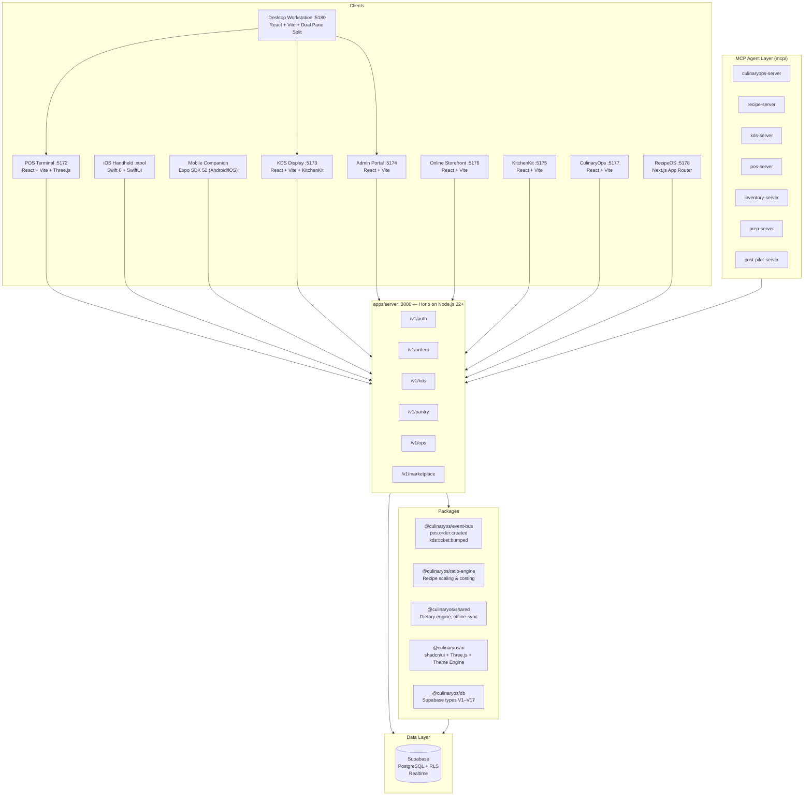

---

## 📱 Native Mobile & Handheld Ecosystem (iOS via xtool + Android via Expo)

CulinaryOS delivers zero-compromise physical ergonomics across both iOS and Android handheld surfaces:

### 1. Native Swift 6 iOS Handheld (`apps/CulinaryOSHandheld`)
- **Compilation Toolchain:** Native Swift 6.1 targeting iOS 17+, scaffolded and managed via `xtool` on Windows (`xtool.yml` bundle `com.shadowwalker.culinaryos.handheld`).
- **Physical Touch Ergonomics (Jakob's Law):** 78px circular numeric keypad touch targets with system haptic feedback and instant 4-digit PIN authentication (`KeypadPinView`).
- **Tableside Ordering & Cart:** Real-time table selection, dynamic menu filtering, modifier grouping, and ergonomic bottom-sticky "Send to Kitchen" action tray (`TablesideOrderView`).
- **Live Ticket Status:** View active dining room and bar tickets with status pills (`PENDING`, `PREPARING`, `READY`), and one-tap "Mark Ready" or "Close & Pay" (`ActiveTicketsView`).
- **Offline Seed Engine:** Fallback offline menu catalog, staff PINs, and table orders to guarantee non-stop tableside service during Wi-Fi dropouts.

### 2. Universal Android & Manager Companion (`mobile/`)
- **Framework:** Expo SDK 52 + React Native with TypeScript and Zustand store.
- **Live Shift Telemetry:** Real-time dashboard with daily sales revenue, active covers, occupied tables, and average ticket pacing updated continuously.
- **1-Tap Fast PIN Switcher:** Effortlessly switch active staff personas between Manager (`1234`), Server (`5678`), Chef (`9012`), and Bartender (`3456`).
- **Kitchen Chit Bump Engine:** Interactive chit cards with visual status pills, modifier badges, and 1-tap ticket bump routing.
- **Catalog 86 Control:** Instantly toggle `IN STOCK` vs `86'D` inventory statuses, immediately propagating locks across all POS terminals and customer tableside QR menus.
- **Pantry Par Shortfall Audits:** View inventory levels against minimum par thresholds with unit cost metrics.

---

## 🎨 shadcn/ui Design System & Universal Theme Engine

CulinaryOS includes a centralized design system in `@culinaryos/ui` built on **Radix UI**, **Tailwind CSS**, and **Three.js**, with a live **Theme Customizer**:

### Theme Presets
- **Classic Bistro (Light)**: Clean warm linen, balanced typography, elegant fine dining.
- **Midnight Slate (Dark)**: Deep navy slate (`#090d16`), cyan accents, low-light evening bar feel.
- **Kitchen OLED (Pure Black `#000000`)**: Zero eye strain high-heat high-contrast mode for busy commercial kitchen lines.
- **Cyberpunk Neon**: Electric cyan (`#06b6d4`), magenta accents, modern lounge style.
- **Botanical Garden (Emerald)**: Forest green (`#047857`), sage, warm cream farm-to-table aesthetic.
- **Bordeaux & Wine**: Intimate steakhouse, ruby crimson (`#e11d48`), rich deep tones.

### Micro-Interaction Animations
- `.animate-ticket-arrive`: Spring bounce animation (`cubic-bezier(0.34, 1.56, 0.64, 1)`) on order fire.
- `.animate-ticket-bump`: Smooth exit slide & scale fade on KDS ticket completion.
- `.animate-scale-spring`: Elastic button pop and table focus feedback.

See [`docs/UI_THEME_CUSTOMIZER.md`](docs/UI_THEME_CUSTOMIZER.md) for direct CSS token export and React usage.

---

## Surfaces & Applications

| Package | Port / Target | Role |
|---|---|---|
| `apps/desktop` | `:5180` | **Desktop Workstation Hub** — Unified split-screen manager, F1–F6 hotkeys, theme switcher, kiosk mode |
| `apps/marketing` | `:5179` | **CulinaryOS.io SaaS Portal** — Next.js 14 marketing, pricing matrix, trial signup, blog, and RecipeOS showcase |
| `apps/server` | `:3000` | Unified Hono API — authentication, orders, KDS, reservations, pantry, payments, billing, ops, marketplace |
| `apps/pos` | `:5172` | POS terminal (PIN login, 2D/3D floor map, ESC/POS hardware printer hub, live text scaling, PWA offline) |
| `apps/kds` | `:5173` | Kitchen Display System (real-time tickets, station filters, course hold/fire, TV 140% mode, PWA offline) |
| `apps/admin` | `:5174` | Admin portal — menu editor, staff PINs, custom role builder, pantry par levels, system settings, themes |
| `apps/kitchenkit` | `:5175` | KitchenKit — Recipe catalog, station prep planner, par levels, vendor management, shelf life |
| `apps/web` | `:5176` | Online ordering storefront (FDA Top 9 dietary filtering, cart customization, instant checkout) |
| `apps/ops` | `:5177` | CulinaryOps — Real-time food cost analytics, waste logging, labor %, and vendor performance |
| `apps/recipeos` | `:5178` | RecipeOS — Next.js recipe vault, ratio scaling engine, unit conversions, and shopping list |
| `mobile/` | Android/iOS | React Native + Expo Mobile POS with offline SQLite cache |
| `packages/sdk` | Shared | **@culinaryos/sdk** — Official TypeScript Client SDK for orders, KDS, reservations, billing, reports |
| `packages/commissary-engine` | Shared | Multi-unit stock replenishment, central production batching, and franchise royalty ledgers |
| `packages/forecast-engine` | Shared | Predictive kitchen demand smoothing, bottleneck advisories, and adaptive safety-stock par levels |
| `packages/loyalty-engine` | Shared | Customer points, digital punch cards, gift card redemption, and dual-sided referral credits |
| `packages/accounting-engine` | Shared | Double-entry General Ledger reconciliation, QuickBooks Online IIF, Xero CSV, and P&L metrics |
| `packages/ui` | Shared | Centralized **shadcn/ui** design system, Three.js 3D canvas, and Universal Theme Engine |
| `packages/shared` | Shared | Unified settings engine, dietary filter engine, printer driver, offline-sync delta engine |
| `packages/ratio-engine` | Shared | Baker's percentage calculations, yield formulas, and batch scaling |
| `packages/prep-engine` | Shared | Recipe prep task management and batch requirement calculations |
| `packages/food-cost-engine` | Shared | Pure functions for actual vs theoretical food cost variance calculations |
| `packages/waste-engine` | Shared | Kitchen waste summarization and top cost-leakage analysis |
| `packages/labor-engine` | Shared | Shift labor hours, role-weighted tip pooling, and labor cost percentage calculations |
| `packages/pdf-tools` | Shared | Print-ready PDF menu export, Z-Report financial closeout PDF, and QR code generators |
| `packages/template-engine` | Shared | Multi-concept restaurant website and menu template token engine |
| `packages/seo-tools` | Shared | Schema.org JSON-LD structured data generators for restaurant menus and locations |
| `packages/asset-tools` | Shared | OpenGraph banner generator (`satori`), favicons, and palette extractors |
| `mcp/` | Extension | 9 Model Context Protocol servers + Python Post-Pilot loyalty agent |

---

## Quick Start (Local Demo Mode)

Run the entire system locally in under 30 seconds with **zero database setup and zero external API keys**:

### Prerequisites

- [Node.js 22+](https://nodejs.org/)
- [pnpm 9+](https://pnpm.io/installation) (`npm install -g pnpm`)

### Boot

```bash
# 1. Clone repository and install dependencies
git clone https://github.com/ShadowWalkerNC/CulinaryOS.git
cd CulinaryOS
pnpm install

# 2. One-command turnkey boot (launches Desktop Hub, POS, KDS, Admin, Web, and API)
pnpm quickstart
```

*(On Windows you can also run `.\scripts\install.ps1`, or `./scripts/install.sh` on macOS/Linux).*

**Interactive walkthrough:** See [`QUICKSTART.md`](QUICKSTART.md).

### Demo Credentials

| Surface | URL | Credential |
|---|---|---|
| **Desktop Workstation** | [localhost:5180](http://localhost:5180) | F1–F6 quick switch · Kiosk mode · Split view |
| **POS Terminal** | [localhost:5172](http://localhost:5172) | Demo mode PINs: `1234` (server) · `5678` (manager) — demo PINs are rejected on live/production paths |
| **Kitchen Display (KDS)** | [localhost:5173](http://localhost:5173) | No login required |
| **Admin Portal** | [localhost:5174](http://localhost:5174) | No login required |
| **Online Storefront** | [localhost:5176](http://localhost:5176) | No login required |
| **KitchenKit** | [localhost:5175](http://localhost:5175) | No login required |
| **CulinaryOps** | [localhost:5177](http://localhost:5177) | No login required |
| **RecipeOS** | [localhost:5178](http://localhost:5178) | No login required |
| **Unified Hono API** | [localhost:3000](http://localhost:3000) | `X-Tenant-Id: 00000000-0000-0000-0000-000000000001` |

In offline/demo mode, POS serves a sample menu, buffers transactions to localStorage, and communicates with the in-memory mock kitchen store on the API. POS and KDS do **not** share live state in demo mode — use a live Supabase backend for cross-app POS→KDS order flow.

---

## Operations Consultant & Daily Audits

CulinaryOS includes an autonomous **Restaurant Operations Manager & Consultant** framework for continuous review of hospitality workflows:

```bash
# Run daily operations audit & generate report
pnpm ops:audit

# View the latest operational critique
cat docs/DAILY_OPERATIONS_REPORT.md
```

The audit evaluates speed-of-service, touchscreen ergonomics, KDS course hold/fire timers, FDA Top 9 allergen classifications, and shared fryer cross-contact risks, and generates targeted daily operational questions for engineering refinement.

---

## Connecting to Live Supabase Backend

To enable multi-device sync, PostgreSQL Row Level Security (RLS), and live Supabase Realtime:

1. Provide valid keys in `.env`:
   ```env
   SUPABASE_URL=https://your-project.supabase.co
   SUPABASE_ANON_KEY=eyJ...
   SUPABASE_SERVICE_ROLE_KEY=eyJ...
   AUTH_RELAXED=false
   ```
2. Apply database migrations:
   ```bash
   npx supabase db reset
   ```
3. Seed multi-organization, multi-venue demo data:
   ```bash
   pnpm seed
   # Applies: base_tenant.sql → menu.sql → demo.sql → multi_venue_orgs.sql
   # Seeds >= 2 Organizations, >= 3 Venues (Bistro, Commissary, Food Truck), recipes, and PO cycle
   ```
4. Start the stack — POS, KDS, Admin, and MCP agents will now operate on your live database with strict tenant isolation.

See [`docs/DEPLOYMENT.md`](docs/DEPLOYMENT.md) and [`docs/architecture.md`](docs/architecture.md) for multi-venue architecture and Docker options.

---

## Security Posture

Security and money-accuracy outrank shipping speed. Current enforcement:

- **Fail-closed authentication** — auth denies by default; relaxed/demo modes require explicit opt-in, never the default.
- **Demo PINs are demo-only** — `1234` / `5678` are rejected on live/production paths, and PIN entry is throttled against brute force.
- **Server-authoritative money** — menu prices are enforced server-side; clients can never set their own prices. Financial math uses integer cents, never floats.
- **No card data, ever** — no PAN storage, no CVV, card data never in logs. Card-present flows go through Stripe Terminal only.
- **Manager gates on sensitive actions** — comp tenders require a manager PIN; refunds and voids are permission-checked.
- **No bundled secrets** — service-role keys never ship in client bundles; credentials live in server env only.

See [`docs/security.md`](docs/security.md) and `AGENTS.md` for the full ruleset.

## Quality & Testing Gate

CulinaryOS enforces strict quality gates across the monorepo:
```bash
# Run complete test suite (178 test suites across all packages and surfaces — 100% green)
node ./scripts/run-all-tests.cjs

# Run workspace-wide typecheck (54 tasks across all packages — 0 errors)
pnpm run typecheck

# Build all packages and applications
pnpm run build

# Run production readiness preflight doctor
pnpm doctor
```

> **Note on lint:** `pnpm run lint` is currently non-functional (eslint configs pending). Use `pnpm typecheck` as the static analysis gate.
>
> **Note on `pnpm test`:** The Turborepo root `#test` task has a known recursive-invocation issue. Use `node ./scripts/run-all-tests.cjs` or `bun test tests/server/` directly.

---

## Repository Structure

```
CulinaryOS/
├── apps/
│   ├── server/             ← Unified Hono API (orders, KDS, pantry, ops, payments)
│   ├── pos/                ← POS terminal (React / Vite / shadcn / Three.js)
│   ├── kds/                ← Kitchen Display client (React / Vite)
│   ├── admin/              ← Admin / pantry portal (React / Vite)
│   ├── web/                ← Online ordering storefront & Studio (React / Vite)
│   ├── ops/                ← CulinaryOS Ops (food cost, prime cost, waste, labor)
│   ├── marketing/          ← Marketing site, SaaS features & Leadership Guild (Next.js 15)
│   ├── desktop/            ← Workstation desktop container with hotkeys (React / Vite)
│   ├── recipeos/           ← Recipe scaling, ratios, and formula vault (Next.js)
│   ├── kitchenkit/         ← Prep station, batch calculators, thermal labels (React / Vite)
│   └── CulinaryOSHandheld/ ← Native Swift 6 / iOS 17 handheld terminal via xtool
├── packages/               ← shared, event-bus, auth, db, ui, config, ratio-engine, sdk, intelligence
├── mcp/                    ← 9 MCP servers — AI agent tool layer
├── mobile/                 ← Universal Android & iOS companion (Expo SDK 52 + React Native)
├── extensions/             ← First-party extension manifests
├── extension_template/     ← Public contract for third-party extensions
├── supabase/               ← Migrations + seeds (V1–V17)
├── cli/                    ← Operator CLI tool (10 command groups, 100% route parity)
├── tests/                  ← 178 integration, empirical, adversarial & e2e test suites
├── docs/                   ← Technical documentation & SaaS runbooks
├── scripts/                ← quickstart, seed, doctor, simulate, ops-audit
├── docker-compose.yml      ← Production container build
├── pnpm-workspace.yaml     ← Monorepo workspace config
├── turbo.json              ← Turborepo pipeline config
└── .env.example            ← All required env vars
```

---

## Screenshots

> All screenshots captured live from the running application.

### 3D Spatial Floor Plan & Table Management
<p align="center">
  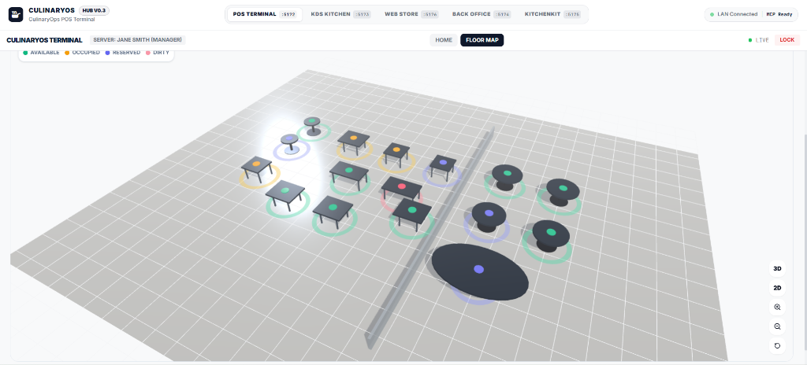
</p>

### Kitchen Display System (KitchenKit — Station Routing)
<p align="center">
  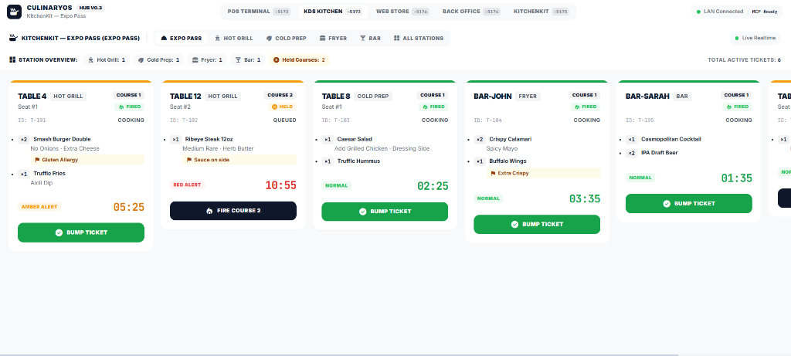
</p>

### POS Terminal — Multi-Seat Ticket Menu
<p align="center">
  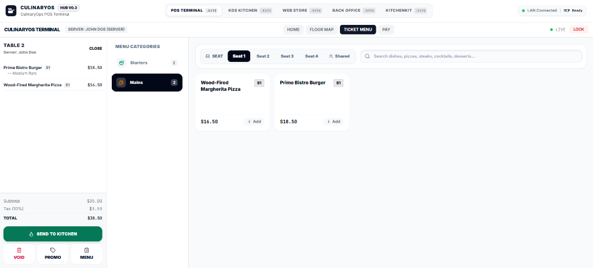
</p>

### Online Customer Storefront
<p align="center">
  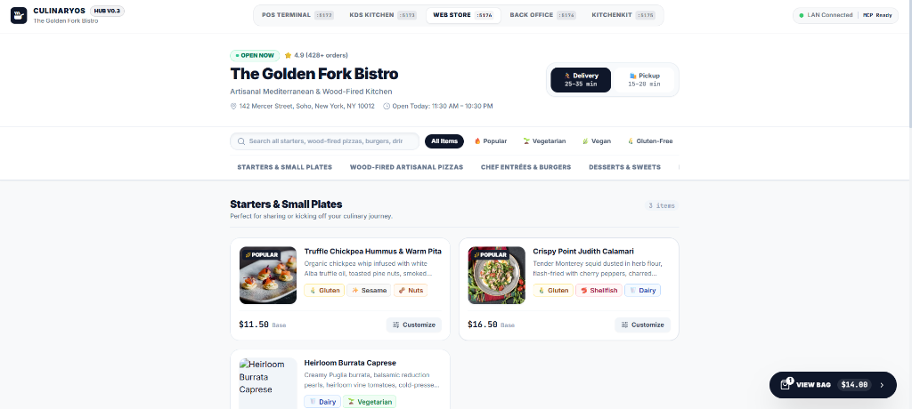
</p>

### Additional Screens
<p align="center">
  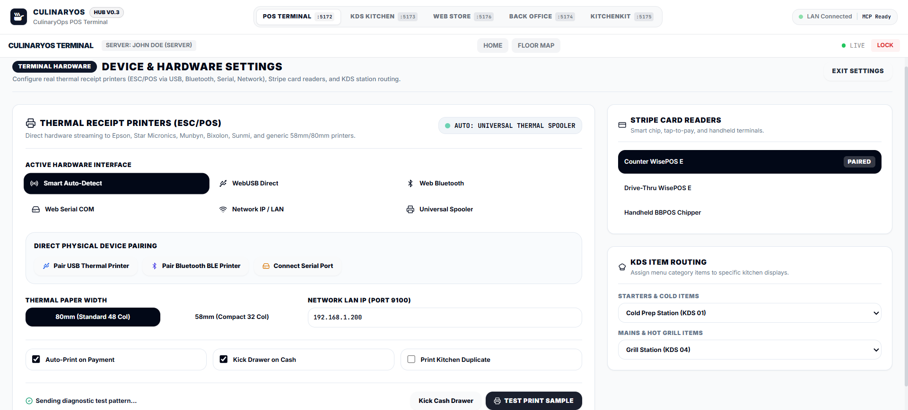
  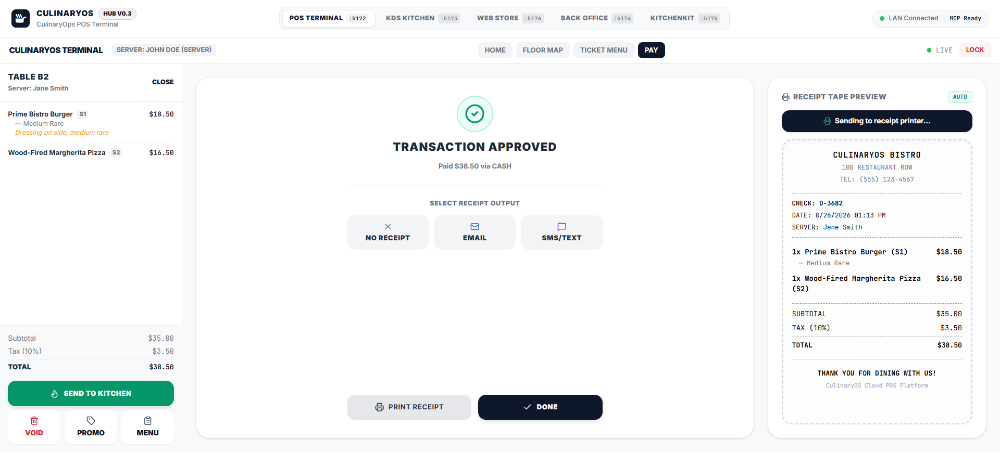
  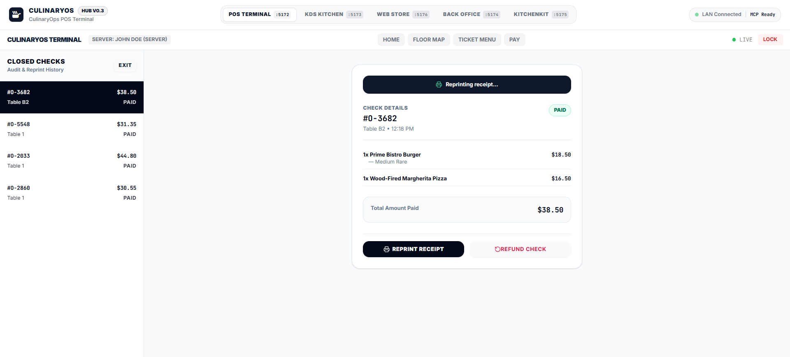
</p>
<p align="center">
  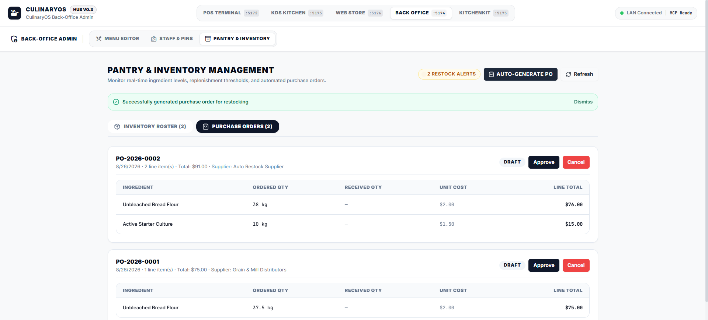
  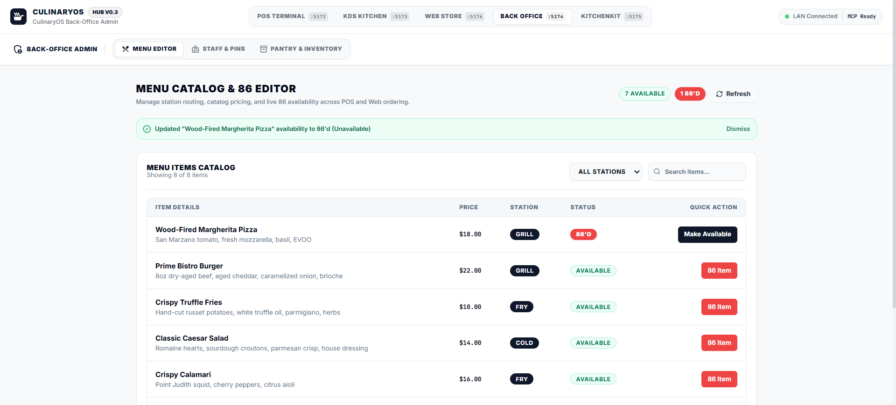
  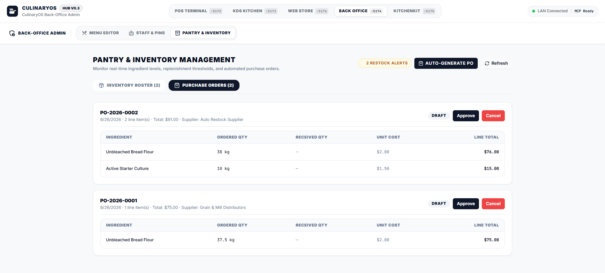
</p>

---

## Contributing

We welcome contributions! Please read [`CONTRIBUTING.md`](CONTRIBUTING.md) before opening a PR.

- **Branch naming:** `feature/[module]-[description]` · `fix/[module]-[issue]` · `docs/[scope]`
- **Commit format:** [Conventional Commits](https://www.conventionalcommits.org/) — `feat(pos): ...`, `fix(kds): ...`, `docs(readme): ...`
- **Non-negotiable:** every database query must be scoped by `tenant_id` / RLS. Unscoped queries are rejected.

---

## Community & Support

- **Leadership & Engineering Guild:** [Meet the Team](file:///c:/Users/white/Documents/GitHub/CulinaryOS/apps/marketing/src/app/team/page.tsx) (`/team` across marketing and web)
- **Bug reports & feature requests:** [GitHub Issues](https://github.com/ShadowWalkerNC/CulinaryOS/issues)
- **Questions & discussion:** [GitHub Discussions](https://github.com/ShadowWalkerNC/CulinaryOS/discussions)
- **Architecture & API docs:** [`docs/`](docs/)
- **Extension development:** [`extension_template/`](extension_template/)

---

## License

[MIT](./LICENSE) — Own your stack. Built with TypeScript, React, Vite, Three.js, Radix UI, Hono, Supabase, Turborepo, and Model Context Protocol (MCP).
