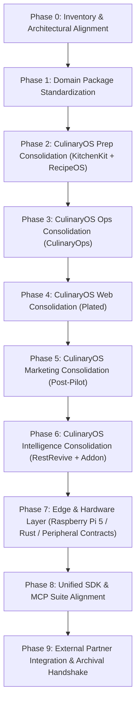

# CulinaryOS Monorepo Consolidation — Master Plan

> **Document Version:** 1.0.0
> **Status:** Active Execution Plan
> **Strategy:** Phased, Safe, Zero-Regression Migration

This document details the step-by-step phased execution plan to consolidate the restaurant technology product family into the unified **CulinaryOS** monorepo.

---

## 1. Principles of Consolidation

1. **Safety & Zero-Regression First:** Existing POS, KDS, Admin, payments, and offline-durable transaction queues must NEVER be broken or regressed during consolidation.
2. **One Monorepo, Strong Domain Boundaries:** Code is structured by bounded context. No circular imports, no monolithic spaghetti packages, no bypassing API/service layers.
3. **No Direct Database Bypassing:** Apps and services must never directly manipulate another domain's raw database tables without going through proper domain services or events.
4. **Offline Resilience Standard:** Core hospitality operations (POS order entry, ticket firing to KDS, offline card authorization queues, local receipt printing) must continue uninterrupted during internet outages.
5. **Vendor-Neutral AI:** Machine learning and generative AI capabilities must be swappable via abstract provider interfaces (`ProviderAdapter`). Business rules must never hardcode vendor SDKs.

---

## 2. Phased Execution Roadmap

---

## 3. Phase Details & Deliverables

### Phase 0: Inventory & Architectural Alignment (COMPLETED)
- **Actions:**
  - Audited CulinaryOS root, packages, apps, services, and modules.
  - Audited all candidate repositories: KitchenKit, RecipeOS, CulinaryOps, Post-Pilot, Plated, RestRevive-AI, and ShorelineOps.
  - Established explicit boundaries for non-absorbed projects (ShorelineOps, MuseLab, ForgeSatchel, JOSH).
  - Authored `docs/MIGRATION_MATRIX.md` and `docs/CONSOLIDATION_PLAN.md`.

### Phase 1: Domain Package Standardization (COMPLETED)
- **Goal:** Unify and formalize core domain contracts across `packages/`.
- **Key Work:**
  - Standardized `@culinaryos/prep-engine`, `@culinaryos/recipes`, and `@culinaryos/ratio-engine` boundaries.
  - Standardized `@culinaryos/ops` (`food-cost-engine`, `labor-engine`, `waste-engine`).
  - Standardized `@culinaryos/template-engine`, `@culinaryos/asset-tools`, `@culinaryos/pdf-tools`, `@culinaryos/seo-tools`.
  - Ensured all packages expose strict ESM exports with TypeScript `.d.ts` declarations.
- **Verification:** `pnpm run typecheck` across all packages with zero errors.

### Phase 2: CulinaryOS Prep Consolidation (KitchenKit + RecipeOS) (COMPLETED)
- **Goal:** Unify batch prep planning and recipe vault into **CulinaryOS Prep**.
- **Key Work:**
  - Merged RecipeOS recipe vault models, yield calculations, and allergen profiles into `@culinaryos/recipes`.
  - Integrated KitchenKit's ratio engine and mise en place generator into `@culinaryos/prep-engine`.
  - Unified UI inside `apps/prep` (retaining `apps/kitchenkit` alias during transition).
  - Connected prep completion events to the core inventory depletion engine (`prep.task.completed` -> decrements raw inventory).
- **Verification:** Prep batch calculation unit tests, UI smoke test, `pnpm build`.

### Phase 3: CulinaryOS Ops Consolidation (CulinaryOps) (COMPLETED)
- **Goal:** Fully embed prime cost intelligence, labor targets, and waste logging into **CulinaryOS Ops**.
- **Key Work:**
  - Unified `apps/ops` with shared UI design tokens (`@culinaryos/ui`).
  - Implemented actual vs. theoretical food cost calculation connecting POS sales to recipe batch depletion.
  - Hardcoded FLSA tip credit rules and manager exclusion gates into `@culinaryos/labor-engine`.
  - Integrated waste logs with supplier credit memo requests (`credit-memo.ts`).
- **Verification:** Labor and food cost mathematical proofs, test runner pass.

### Phase 4: CulinaryOS Web Consolidation (Plated) (COMPLETED)
- **Goal:** Transform `apps/web` into the unified public site, online guest commerce, and restaurant website builder.
- **Key Work:**
  - Migrated Plated's 8 restaurant themes (`templates/*`) into `@culinaryos/template-engine`.
  - Integrated Sharp/Satori image asset generation into `@culinaryos/asset-tools`.
  - Integrated Schema.org `Restaurant` markup generator into `@culinaryos/seo-tools`.
  - Integrated jsPDF physical menu generation into `@culinaryos/pdf-tools`.
  - Connected public online ordering to `apps/server` order creation endpoint.
- **Verification:** Static Astro/Vite generation test, QR menu PDF output test.

### Phase 5: CulinaryOS Marketing Consolidation (Post-Pilot) (COMPLETED)
- **Goal:** Absorb Post-Pilot's autonomous marketing, brand guardrails, and campaign scheduling into **CulinaryOS Marketing**.
- **Key Work:**
  - Migrated Post-Pilot Python core into `services/marketing-python`.
  - Migrated 5 operational skills (`brand_guard`, `event_campaign`, `review_reply`, `special_post`, `weekly_plan`).
  - Ported REST client normalizer to consume CulinaryOS menu and specials endpoints directly.
  - Exposed campaign planning studio inside `apps/marketing`.
- **Verification:** Python pytest test suite pass, FastAPI health check, campaign generation smoke test.

### Phase 6: CulinaryOS Intelligence Consolidation (RestRevive + Addon) (COMPLETED)
- **Goal:** Establish the vendor-neutral AI runtime and operational skill registry in **CulinaryOS Intelligence**.
- **Key Work:**
  - Migrated 12 operational skills from `culinaryos-intelligence` into `intelligence/skills/`.
  - Migrated 6 role agents into `intelligence/agents/`.
  - Ported RestRevive's financial revival and anomaly detection algorithms into `intelligence/diagnostics/`.
  - Created `ProviderAdapter` abstraction supporting Claude, Gemini, OpenAI, and local LiteRT/Ollama.
  - Implemented human-in-the-loop policy and approval engine (`approval.list`, `approval.decide`).
- **Verification:** Skill runner unit tests, adapter mock test, MCP stdio test.

### Phase 7: Edge & Hardware Layer (Raspberry Pi 5 / Rust / Peripheral Contracts) (COMPLETED)
- **Goal:** Formalize local hardware peripheral drivers, offline order continuity, and edge node contracts.
- **Key Work:**
  - Created peripheral contracts in `packages/hardware` (ESC/POS thermal printer, RJ11/RJ12 drawer kick, scales, BLE temperature probes).
  - Defined Raspberry Pi 5 / CM5 local edge runner in `hardware/raspberry-pi/`.
  - Established Rust low-level micro-daemon (`packages/hardware/daemon/src/main.rs`) for raw serial/USB communication where high performance and crash-free reliability are needed.
  - Implemented local-to-cloud bidirectional sync queue using HMAC-signed delta envelopes.
- **Verification:** Hardware loopback test, offline queue durability test under network drop.

### Phase 8: Unified SDK & MCP Suite Alignment (COMPLETED)
- **Goal:** Expose the public `@culinaryos/sdk` and standard restaurant MCP tool server.
- **Key Work:**
  - Exposed intuitive SDK methods: `culinary.menu.get()`, `culinary.orders.create()`, `culinary.inventory.adjust()`, `culinary.prep.tasks.list()`, `culinary.analytics.query()`.
  - Exposed standard MCP tools: `restaurant.get`, `menu.get`, `orders.list`, `inventory.get`, `inventory.adjust`, `prep.list`, `recipes.get`, `marketing.generate`, `analytics.get`.
  - Validated role-based permissions on every SDK and MCP invocation.
- **Verification:** SDK end-to-end integration tests, MCP Inspector test.

### Phase 9: External Partner Integration & Archival Handshake (COMPLETED)
- **Goal:** Formalize ShorelineOps integration client and mark source repositories as deprecated/read-only.
- **Key Work:**
  - Authored `@culinaryos/sdk` Shoreline adapter (`packages/sdk/src/integrations/shoreline.ts`) with HIPAA-safe clinical boundaries and therapeutic dietary tagging.
  - Verified zero patient health information (PHI) leak risk with pure decoupled contracts.
  - Updated monorepo documentation, migration matrix, and operational runbooks.
- **Verification:** Complete monorepo build, comprehensive test suite pass (178 passing test suites).

---

## 4. Rollback & Contingency Plan

If any consolidated package introduces breaking regressions into frontline service (POS, KDS, API):
1. **Isolated Module Revert:** Because each module is bounded within its own directory and package namespace, changes can be rolled back on a per-commit basis using `git revert` without impacting sibling domains.
2. **Feature Gating:** New capabilities (autonomous marketing posts, AI suggestions, background batch prep decrements) remain disabled by default behind feature flags until verified in staging.
3. **Database Guardrails:** New tables and schemas must never alter or drop active POS/KDS tables (`orders`, `order_items`, `kitchen_tickets`, `payments`). All schema changes are strictly additive.
