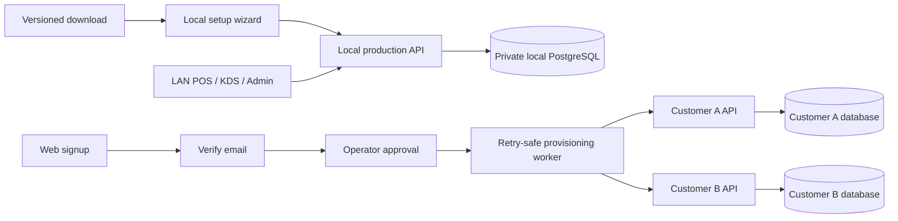

# CulinaryOS hybrid release plan

Revision 2, 2026-11-10. Working baseline: HEAD `4ca345f` plus pre-existing uncommitted release work. **Release status: NOT CERTIFIED.** This is the current execution checklist; [RELEASE_READINESS.md](RELEASE_READINESS.md) retains prior evidence. No historical test count is a current acceptance result.

## Product requirements

| ID | Required outcome | Release evidence |
| --- | --- | --- |
| HYB-01 | Private local server, installed without developer knowledge; POS/KDS/admin clients connect on the customer's LAN | Fresh supported-machine install; no developer tools required by the user; persistent records; reboot and LAN-device test |
| HYB-02 | Operator-managed Railway service; signup and approval; each customer gets a separate database | Two approved synthetic customers, distinct databases/credentials; cross-customer denial; retry-safe provisioning and recovery |
| HYB-03 | Limited local edition and managed service capabilities | Reviewed feature matrix; server enforcement; core local operations remain usable without licensing network access |
| HYB-04 | One codebase with separately packaged server, clients, MCP and marketing | Versioned artifacts and explicit dependency boundaries; no requirement to install development-agent tools |
| HYB-05 | Resumable team development without a mandatory model provider | Task ownership, evidence and handoff recorded; no Muse dependency; replacement worker can resume from repository state |

Exact local feature limits, paid tiers, supported OS versions and offline installer size remain product decisions. Existing prices in SAAS_TIERS.md are not approved by this plan. Offline restaurant operation and installation with no internet are separate acceptance cases.

## Current evidence and errors to correct

- `apps/*`, `packages/*`, `cli/`, `mcp/` already provide a monorepo boundary. Moving folders or splitting repos does not fix installation or tenancy.
- `docker-compose.yml` has API and four clients but explicitly no PostgreSQL. Same-origin nginx improvements are present in the dirty tree; container/LAN acceptance remains open.
- `scripts/install*` install source dependencies and launch development services. The clean profile does not create a restaurant or production database.
- `apps/desktop` is a Vite browser shell, not a native server installer. A desktop client and a local server are different deliverables.
- `packages/db` owns native migrations and restricted-role checks. `apps/server/src/postgres/startup.ts` binds one pool/database per process. Native signup and full route parity remain incomplete. Legacy Supabase migrations cannot simply be substituted for the native chain.
- Existing tenant CLI and pilot simulations do not prove native production provisioning. Never seed example PINs into customer environments.
- Historical ledger claims of production readiness conflict with missing acceptance evidence. Prior Railway observations are dated; live deployment status was not refreshed in this slice.
- `.ai` records were unfilled templates. They now locate actual work and remaining gates.

## Architecture and ownership

Keep one repository and shared restaurant domain packages. Separate build artifacts and deployment profiles:

| Component | Local edition | Managed edition | Code owner/location |
| --- | --- | --- | --- |
| Restaurant API | Production local service | Initially one API instance per customer | `apps/server` |
| Restaurant records | Persistent local PostgreSQL | Dedicated database and runtime credentials per customer | `packages/db`; unit RLS retained |
| POS, KDS, manager, guest UI | Local same-origin gateway; browser clients | Customer HTTPS endpoint | `apps/{pos,kds,admin,web}` |
| Desktop/mobile/display | Optional clients of assigned server | Optional clients of assigned server | Existing app packages |
| Marketing | Public downloads/docs/signup entry | Public downloads/docs/signup entry | `apps/marketing`, distinct from `apps/web` |
| Managed control plane | Not installed | Approval, customer registry, provisioning, entitlements, update tracking | Proposed isolated service; location/schema to be approved in its implementation slice |
| MCP | Optional authenticated adapter | Optional authenticated adapter | `mcp/`; same authorization rules as API |
| Orca/Herdr/development agents | Not part of customer installation | Not part of customer runtime | External development tooling |

For the first managed release, a dedicated API/database deployment per customer fits the current single-pool server and limits blast radius. This is a proposed implementation choice, not deployed topology. Revisit shared API database routing only when measured cost/scale warrants its extra connection-pool, identity-routing and recovery complexity. A customer organization can own several unit tenants inside its database; keep per-unit RLS. Never select a database from an untrusted tenant header or user-supplied connection string.

Railway supports private service networking and PostgreSQL persistence; enable and test the chosen backup facilities explicitly. See [PostgreSQL](https://docs.railway.com/databases/postgresql), [private networking](https://docs.railway.com/networking/private-networking/how-it-works), and [backup/restore guidance](https://github.com/railwayapp/docs/blob/main/content/guides/postgres-backups-restores.md). These capabilities do not prove our application uses them correctly. Deployment costs must be measured before customer capacity or pricing promises.

Managed lifecycle: requested -> email_verified -> approved -> provisioning -> ready; failures enter provisioning_failed with resumable step records. Ready requires schema, restricted role, owner setup, API readiness and endpoint checks. Approval is an authenticated operator action, never a client boolean. Reservation/idempotency keys prevent duplicate infrastructure. Suspension/plan expiry must preserve records and export/recovery access; do not delete databases automatically.

Proposed control-plane records: customer ID/status/approved-by; deployment ID/version; database secret reference (never plaintext credentials); provisioning operation and step status; entitlement revision/features; migration/recovery audit. Restaurant operational data stays in the customer database. Control-plane identity is a separate security boundary; design and test it before implementation.

## Feature access

Use deployment mode, entitlements, and staff permissions as separate checks. SaaS entitlements are checked by the server against authoritative customer state. Offline paid add-ons, if offered, can use asymmetric signed licenses scoped to installation/customer, features, revision and validity; private signing keys stay operator-side. Never use a shared unlock password or trust localStorage. License expiry must not interrupt an active order or obstruct data recovery. Exact expiry/grace rules require a business decision and tests.

Public source can be modified by its owner: licensing cannot guarantee unmodifiable local restrictions. Protect genuinely hosted services with server authentication and service entitlements. Decide commercial source licensing separately; a second private repository is only needed for an intentional source-publication boundary. Do not add paid gates to existing functionality in this planning slice.

## Revision 2: execution order and acceptance corrections

1. **103A: database and first owner, before containers.** Use the existing migration CLI on a new PostgreSQL database. Run an explicit operator-only bootstrap command after verifying the migration ledger. In one transaction, refuse existing restaurant/user data and role collisions, create the restricted runtime login, and insert the restaurant, owner membership and PIN proof. No changes to existing migrations, no remote HTTP bootstrap, no demo records, no passwords or PINs in argv or output. Test on two empty disposable databases and check both direct DB and native API behavior.
2. **103B/104: test as the restaurant.** Start the native API using only the runtime credential; prove restart, owner login, menu/order/send/KDS/cash close and client contract parity. If a client assumes a demo tenant or legacy identity, fix that boundary before bundling it.
3. **105/106: package that proven path.** Build versioned server artifacts and clients; migrate in an isolated one-shot setup/upgrade job. Keep PostgreSQL and owner credentials away from the LAN and from the running API process. Test restart, recovery, LAN devices and a clean Windows/Linux machine. Separate initial internet download from offline operation and fully offline installation.
4. **107–110: SaaS as a separate release track.** Start in a disposable Railway preview with two customer deployments and separate PostgreSQL services. Do not offer public PIN-only onboarding; build verified email, approval, safe routing, provider retries and per-customer recovery first. A shared PostgreSQL cluster, if later considered, requires explicit database ACL and role isolation design because PostgreSQL login roles are cluster-wide. Nothing in the local bootstrap creates Railway resources or grants SaaS entitlements.

Team execution: `/team resume` and `/team status` recovered the CulinaryOS handoff. The read-only Codex review call timed out (JOSH CULINARYOS-9553); no review result was accepted. The coordinator owns this dirty checkout, and the existing Orca workspace tracks the stage. Run only one implementation writer; any future concurrent writer needs a separate worktree and explicitly reviewed base. No Muse or paid fallback.

## Ordered execution checklist

Each row is a separate reviewable stage; stop expansion at its acceptance boundary. Estimates are planning ranges, not a token budget authorization.

| ID / status | Scope and files | Acceptance | Est. tokens | Rollback |
| --- | --- | --- | --- | --- |
| CULINARYOS-101 DONE | This plan; `.ai` records; shared ledger | Concrete map, owners, pending gates | 4-8k | Revert only new documentation changes |
| CULINARYOS-102 DONE; checks in handoff | `scripts/install*`, quickstart; `tests/installer` | Native setup failures stop; no false production claim | 3-6k | Revert this installer slice |
| CULINARYOS-103A DONE (disposable PG) | Server-side operator bootstrap CLI, native setup tests and docs | Verified migration ledger; distinct runtime credential; first owner; atomic refusal/rollback; native API login on disposable DB | 8-14k | Remove unshipped command; disposable databases only |
| CULINARYOS-103B DONE (local process) | Startup/restart acceptance and installer handoff | Persist data across process restart; durable secret injection; no migration credential in runtime | 4-8k | Prior pinned artifact/backup |
| CULINARYOS-104 IN PROGRESS (API verified) | Native API/client contract tests, POS/KDS/admin | Login -> menu -> order -> send -> ticket -> cash close; CLI parity; unavailable features explicit | 15-30k | Feature-gated native cutover; retain previous artifact |
| CULINARYOS-105 PENDING | Existing Compose plus production distribution under deployment/scripts directories | Persistent PG; migration job; restricted runtime secret; readiness; TLS/LAN; reboot; dump/restore | 12-25k | Restore verified backup with prior pinned artifact |
| CULINARYOS-106 PENDING | Release CI, Windows/Linux installer manifests and signed artifacts | Bundled runtime/images; checksums; uninstall retains data; optional offline media; fresh supported machines | 15-30k | Previous signed artifact and tested data backup |
| CULINARYOS-107 PENDING | Managed control-plane service/schema/CLI | Verified signup + manual approval; retry-safe A/B provisioning; separate databases and credentials; no orphan spending | 20-40k | Preview only until accepted; disable provisioning, preserve records |
| CULINARYOS-108 PENDING | Entitlement API/client adapters/CLI | Approved matrix; deny direct unauthorized API calls; preserve local core and recovery | 10-20k | Prior entitlement revision; no data deletion |
| CULINARYOS-109 PENDING | Railway preview config, marketing links, acceptance packets | Two real preview customer workflows; migration canary; backup restore; domain/email delivery | 10-20k | Prior deployment plus backup; explicit production release gate |
| CULINARYOS-110 PENDING | Operator/device/hardware evidence | Windows/Linux install; LAN tablet; printer/drawer; real Stripe test account; rush/offline/recovery; accessibility | 5-15k + operator time | Restrict beta; do not claim general availability |

First release scope is the core restaurant vertical workflow. Extra marketing automation, AI, HR integrations and all existing app surfaces are individually gated by capability evidence; presence in the repo does not mean parity is complete. Exact reduced-edition limits remain undecided.

## Future Rust desktop app

Use the versioned HTTP API for the existing clients and a future Rust desktop app. Keep order, kitchen, tenant and payment rules in the server so each client sees the same results. The existing Rust hardware daemon remains the device integration point. Finish the KDS list and action contracts and the cash workflow before choosing a desktop shell. Verify any later Rust client against the same contracts and test the packaged app separately.

## Development routine and shared records

One coordinator reads `.ai/TASKS.md`, Git status and `docs/AI_SHARED_LEDGER.md`, claims a bounded task and delegates independent files or read-only review. Use separate worktrees for implementation workers. A worktree starts from committed state: explicitly transfer/review required dirty patches before assigning a task dependent on them. Each worker returns paths, revision, tests and unresolved gates. The coordinator reviews and updates this checklist.

Orca status was verified ready/connected on 2026-11-10 using `orca status --json` outside the sandbox after EPERM. This proves runtime reachability, not worker launch, Gemini availability, Herdr failover, or end-to-end remote chat control. This session used a Codex review worker, not Muse. No global router/provider configuration was changed. Use Orca as the primary workspace/task view; avoid two schedulers assigning the same file. Herdr may supply workers only through an explicit adapter/ownership contract. Test one supervised read-only Orca worker before enabling automatic dispatch.

Five-hour work-window routine: resume one task; record scope and acceptance; implement/check/review; checkpoint before provider limits; release ownership. When a worker fails, preserve logs and its patch, stop duplicate writers, then reassign the remaining task. Do not infer provider reset schedules or remaining quotas. A provider outage must never affect the restaurant runtime.

GitHub remains the versioned source for code, migrations, instructions and accepted decisions. Google Docs can hold collaborative proposals and an editable overview; Drive can hold timestamped reports, screenshots and synthetic review artifacts linked by task ID/commit. No automatic two-way overwrite of instruction files. Import a reviewed Docs change through a Git diff/commit; archive the Doc version/link. Never put live customer data, secrets, databases or working Git directories on that shared drive. Cloud workers clone the same repository and return branches/patches; offline local edits require an explicit sync step. No Drive content was created in this slice.

## Revision 2 execution evidence

- PASS: [native bootstrap runbook](acceptance/NATIVE_BOOTSTRAP.md), 3/3 focused tests against an isolated PostgreSQL 18 loopback cluster. Two fresh databases exercised migrations, duplicate setup refusal, role collision, checksum drift, injected write rollback, real SCRAM login, CLI application with redacted output, restricted role checks and native API owner authentication. A new app/pool could resolve the prior session; the second database rejected it. This is not a full server process restart or a physical database-per-customer Railway trial.
- PASS: Server TypeScript check using the installed compiler and `git diff --check`. No application routes or existing migration files changed. No production database changes or deployment.
- PASS 103B: Two production API processes connected to disposable PostgreSQL 18 with the restricted runtime login. The second process accepted the prior owner session, returned the order written by the first process, and accepted a fresh owner sign-in. NEXT 104: prove the POS/KDS and cash workflow through the client contracts.

## Completion rules

- [ ] Choose supported server OS versions, reduced-edition feature matrix, and hosting cost target.
- [ ] Record current AI hub index/export version before design/standards implementation; prior 2026-11-04 load is historical.
- [ ] Pass each technical stage above with fresh evidence.
- [ ] Obtain operator/device/payment/hardware/recovery acceptance.
- [ ] Review concrete release artifacts and production changes before publication.

Do not equate source checks with installation, local tests with hosted acceptance, or a healthy deployment with functional readiness.
