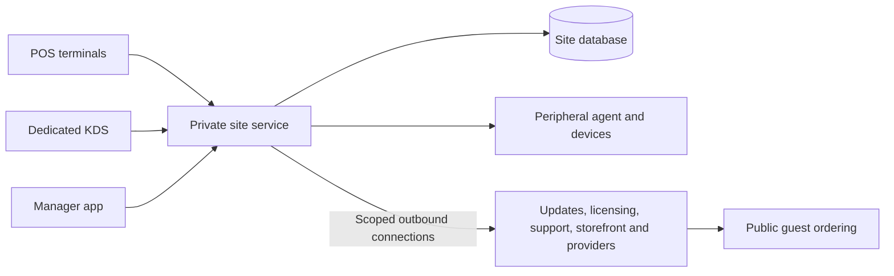

# CulinaryOS Native platform plan

This is the target architecture for the Rust migration. CulinaryOS ships as one product with platform-specific installers and dedicated device packages. Windows, Linux and Android provide the operating system. CulinaryOS provides the installed restaurant environment, enrollment, local services, device roles and fleet management. A bootable CulinaryOS appliance image for certified hardware is an explicit later release milestone. It packages the full restaurant program with a supported host OS and a role-specific first-boot experience.

## N01 — Company, locations and devices

A company owns one or more locations. A location owns its floor plans, tables, tax configuration, stations, devices, cash drawers, orders and local service. A user can have different permissions at different locations. Northern Fixins can enroll ten POS terminals and its kitchen screens under one company, give three managers separate accounts, and publish one storefront tied to the appropriate location. A company entitlement controls installed packages and capacity. Each device has its own revocable identity. Each person signs in separately. The license key grants neither staff authority nor device identity.

The first-run wizard creates or joins a company and site, chooses a host device, provisions storage and the owner, and guides configuration of taxes, menu, tables, roles and stations. On a terminal, it locates the site or accepts an address and short-lived pairing code. A manager approves the device, its assigned role and station. Discovery identifies candidates. Enrollment verifies the site and binds a unique device credential. Replacement or reclassification requires an explicit manager action and revokes the old assignment.

## N02 — Installers and packages

| Profile | Initial platform candidates | Package and authority |
| --- | --- | --- |
| Site server | Windows x64 and Linux x64/ARM64 | Native background service, private datastore, local API, provisioning and recovery tools |
| POS | Windows, Linux and managed Android | Order entry, checkout, assigned peripherals, durable pending operations |
| KDS | Managed Android and Linux ARM64 | Dedicated station display, ticket actions scoped to the station, reconnect and resync |
| Manager | Windows and Linux initially | Licensed Ops, Reports and Admin features plus location-scoped staff permissions |
| Online ordering | Hosted or separately deployed public Rust service | Guest storefront and a limited order exchange with the site |
| Peripheral agent | Certified Windows/Linux hosts | Printer and drawer jobs, health, device diagnostics |
| Minimal display | ESP32-class prototype | Limited display and input for a scoped station, with computing handled by the site |

Produce signed Windows and Linux packages and signed Android apps. Validate installation, upgrade, recovery and uninstall on each supported target. The package manifest declares platform, role, version, dependencies and capability requirements. A Full tier can grant POS, KDS, Ops, Reports, Admin and storefront. Exact tier names, counts, grace periods and pricing remain commercial decisions. Allow approved local operation using a cached signed entitlement and define degraded behavior before expiration. Preserve in-flight service and data access during entitlement changes.

The Android kiosk candidate uses device management and lock task mode on enrolled devices. Prove deployment with the intended management method on actual hardware. Use Rust for application logic and a small platform bridge where a platform SDK requires it. A dedicated KDS package has no POS or Admin surface. Server authorization independently rejects those operations from a KDS credential.

## N03 — Runtime and data ownership

Use one authenticated LAN service address for normal device traffic. Clients use Rust application screens with versioned commands, queries and event streams. The database and internal workers remain private. Each site has one authoritative writer for operational data. Retain PostgreSQL as the starting compatibility target. Use durable local queues on clients and transactional outbox and receipts on the host. Each mutation carries an operation ID and expected revision where conflicts matter. Reconnect resumes from a cursor or retrieves a fresh snapshot. Distinguish locally queued, site accepted, kitchen received and payment settled in the UI.

| Records | Authority and access |
| --- | --- |
| Company, locations, entitlements | Company control plane or explicitly provisioned local owner. Site caches its scoped grant |
| Device identities and assignments | Site enrollment registry, scoped by company, location and role |
| Staff, menu, layout, tax, orders, kitchen and cash ledger | Site authority with explicit company and location boundaries |
| Online ordering inbox | Public storefront holds delivery state, site accepts each external ID once |
| Updates and support sessions | Separate management service with narrow permissions, signed artifacts and audited operator actions |

WAN loss keeps enrolled devices operating through the LAN while the site service is available. Local server loss allows only specifically defined queued operations and displays stale status. Recovery replays with deduplication and surfaces conflicts. The first release uses a documented spare-host restore path. Design and test fencing before any automatic failover. Avoid two hosts accepting writes for the same site.

## N04 — Cloud, support and payment boundaries

Rust services provide the control plane, public storefront, signed update feed and managed Railway option. The self-hosted site opens scoped outbound connections as needed. The public storefront exchanges approved catalog availability and external orders rather than accessing the site database. During an outage show fulfillment availability and avoid confirming an order the site has not accepted under the configured policy. Retain durable delivery status and explicit review of backlog after reconnect. For managed Railway, provision separate customer databases with distinct credentials and restore tests.

Use provider SDKs and certified reader integrations. Keep card data outside CulinaryOS. Prove signature verification, integer-cent reconciliation and safe payment retries. Offer offline card behavior only on a certified provider/device path with tested limits and settlement handling.

Ship signed manifests and payloads, stage updates by platform and device role, check schema and protocol compatibility, and recover after an interrupted update. Use a pilot ring and a site-defined maintenance window. Store audit records locally and expose only approved diagnostics. Support sessions start through an outbound broker after site approval, with named operator authentication, time-limited device and action scope, visible active status and revocation. Start with diagnostics and signed repair actions. Review remote desktop and any broader privileges separately. No shared support credential. Optional background MCP services use scoped credentials, operate through the same API and audit trail, and are enabled per site.

## N05 — Hardware certification

Start with an existing printer, cash drawer and payment reader integration. Reuse the existing Rust hardware daemon where it passes the contract. Use C or a platform bridge for vendor libraries or firmware where needed, with narrow interfaces and isolated processes for privileged I/O. Build a driver only after the standard protocol or supported SDK has been evaluated.

Choose a wired x64 or ARM64 host for the pilot and compare Linux ARM64 and managed Android for the KDS. Certify by actual model and OS, including thermals, display readability, touch, Ethernet or Wi-Fi, reboot recovery and failure behavior. Evaluate ESP32 as a limited KDS display or button controller with server-owned state, authenticated updates and a visible stale state. Full POS and payment workloads go through the certified terminal path. Benchmark a Raspberry Pi reference appliance before custom boards.

## N07 — CulinaryOS appliance image

The long-term release includes a bootable disk image for certified appliances alongside the Windows and Linux installers and Android packages. Start with a Linux ARM64 or x64 image selected through the hardware trial. Use the existing Cargo workspace, package manifests, enrollment protocol and signed releases across all delivery formats.

- **First boot.** Bring up networking and the setup wizard, identify the image role, and enroll with the approved company and location. A server image initializes its local store and owner setup. A terminal image pairs with its site and launches its assigned POS or KDS. Each device generates its own identity during provisioning.
- **Daily operation.** Launch the assigned application or site services after power returns. Report startup, device health, network loss and recovery. Keep restaurant data, device identity and pending transactions in persistent storage across image updates.
- **Updates and recovery.** Verify signed updates for the exact device model and role. Trial an update with a health check and a tested return to the previous bootable image. Coordinate database upgrades with backup and compatibility checks. Prove recovery from interrupted updates and full device replacement using a spare and a verified backup.
- **Release evidence.** Test a clean boot, enrollment, offline operation, power loss, interrupted update, replacement and restore on each certified model. Measure startup and order-to-ticket performance on the lowest-spec device. Qualify the site server image and a dedicated KDS image before expanding to custom boards.

## N06 — Repository restructure and execution

Keep one CulinaryOS repository. Introduce a Cargo workspace for server, domain/protocol, desktop, operator tools and hardware integration. Keep Android packaging with its app. Place installers and release manifests under distribution, test fixtures under the existing test structure, and version the protocol independently of clients. Adopt or move existing code only when its contracts are understood. Maintain legacy migrations, application code and fixtures through rehearsal as migration inputs and behavioral reference. Use additive schema changes, one live writer, backup/restore drills and cent-for-cent reconciliation. No source tree moves are necessary to adopt this plan.

1. **N01/N02 enrollment and setup.** Create one synthetic company, one site, distinct operator and device credentials, and one versioned package manifest. Prove owner setup and denial of access across roles and companies.
2. **N02/N03 native proof.** Deliver one installable Rust site server, one POS, and one dedicated KDS on a representative platform. Prove login, menu, order, ticket bump, cash close and persistence on clean hardware. Carry the existing integration assertions forward.
3. **N03/N05 reliability and cross-platform proof.** Qualify Windows, Linux and Android installers by profile. Simulate ten POS terminals, three managers and kitchen screens under load. Test WAN loss, server loss, stale display, queue replay, replacement, restore and hardware faults. Record cold start, memory, tap response, p95 order-to-ticket time and recovery on the lowest-spec supported equipment.
4. **N04 managed and commercial features.** Verify tier package selection, expired entitlement behavior, interrupted update recovery, customer database isolation, storefront outage handling, provider settlement and owner-approved support.
5. **N06 pilot and migration.** Rehearse migration with synthetic data, then evaluate a controlled restaurant pilot. Complete signed release, hardware certification, reconciliation and support evidence before broader rollout.

6. **N07 appliance image release.** Qualify a bootable site server image and a dedicated KDS image. Reuse signed packages and the site enrollment flow. Verify first boot, power recovery, upgrade and restore on the certified hardware.

The first slice is enrollment plus one POS-to-KDS-and-cash workflow on a private LAN. Framework selection depends on the representative native screen and packaging trial. Pending choices include minimum supported OS and hardware, offline entitlement policy, payment provider certification, recovery targets, and which roles launch on each OS.

## What the competitor documentation supports

- Toast documents a wired local hub that relays updates between devices during internet and service disruption, with subnet and hardware constraints. Validate our own network failure modes separately. [Toast local sync](https://doc.toasttab.com/doc/platformguide/platformOfflineModeLocalSync.html)
- Square documents device and payment-method restrictions, pending offline payment states, and reconnect requirements. Use explicit pending and settled states and certify the chosen hardware/provider combination. [Square offline payments](https://squareup.com/help/us/en/article/7777-process-card-payments-with-offline-mode)
- Aloha documents distinct back-office server, master terminal and network failure cases and site/terminal-specific integration. Test these failures separately and scope service identities to devices and locations. [Aloha reference guide](https://docs.ncrvoyix.com/downloads/aloha-pos/TS199_ReferenceGuide.pdf) and [site and terminal configuration](https://docs.ncrvoyix.com/restaurant/aloha-mobile-pay/implementing/configuring_site_and_terminal_specific_options)
- Android documents dedicated-device lock task mode. Espressif documents LCD controller integration. Each platform still needs CulinaryOS application and device acceptance. [Android lock task mode](https://developer.android.com/work/dpc/dedicated-devices/lock-task-mode) and [Espressif LCD guide](https://documentation.espressif.com/projects/esp-iot-solution/en/latest/display/lcd/lcd_development_guide.html)

## Implementation checkpoint

The Rust crate at packages/native implements the N01 device authorization policy. Its unit tests cover POS, Manager and station-scoped KDS operations, company and site boundaries, and revocation. An authenticated site server must load the assignment from its registry before applying the policy. Enrollment transport, persistent credentials and human permission checks are the next slice. The bootable images remain the N07 release milestone.

The [execution report](NATIVE_EXECUTION_REPORT.md) records the current Rust enrollment prototype, implementation assignments and release gates.
