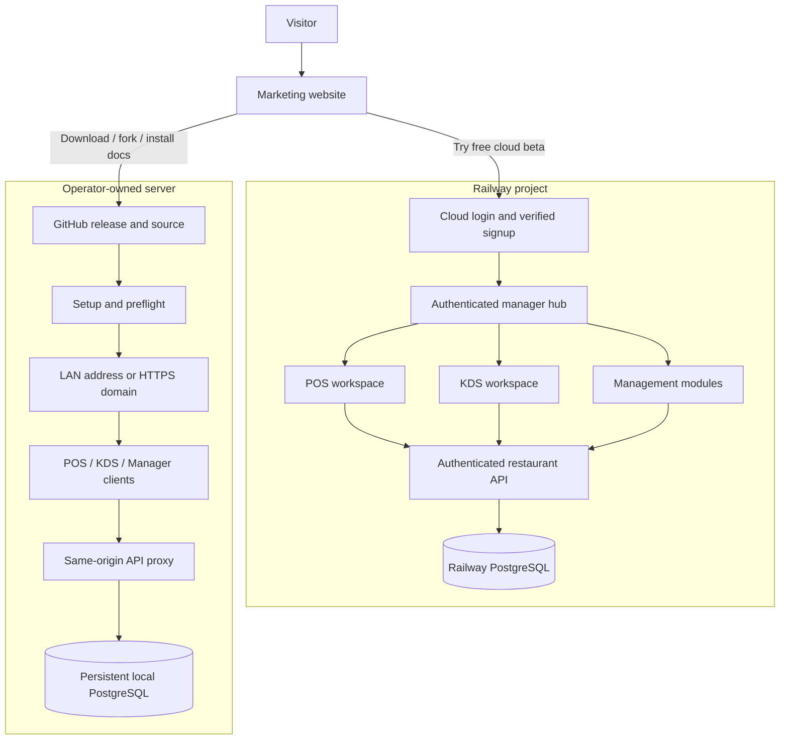

# CulinaryOS release control record

Current execution checklist: [HYBRID_RELEASE_PLAN.md](HYBRID_RELEASE_PLAN.md) (2026-11-10). Dedicated database per approved SaaS customer is now an explicit requirement; the shared-database diagram below is historical and does not satisfy it.

Evidence snapshot updated: 2026-11-04. Status: IN PROGRESS; not certified for public beta.

## Requirements and ownership

The operator authorized implementation of three deliverables from one repository:

| ID | Deliverable | Acceptance |
| --- | --- | --- |
| REL-01 | Downloadable self-host package | Clean-machine install, persistent database, LAN and domain access, restart, backup/restore and documented supported platforms |
| REL-02 | Free Railway SaaS beta | Verified signup, isolated tenant provisioning, first order through POS/KDS, restart persistence and recovery |
| REL-03 | Separate marketing website | Product/docs/download/cloud entrypoints point to the correct deployed destinations; claims match verified capability |
| REL-04 | Human acceptance | Operator and beta testers execute device, workflow and hardware checks; failures recorded |

This authorization supersedes the Vercel/Supabase-first and self-host-later sequencing in docs/SAAS_BETA_MASTER_PLAN.md. Reuse its product boundaries and acceptance cases, while implementing the requested Railway PostgreSQL target.

## Target map (not a claim of current deployment)

Marketing is apps/marketing; apps/web is the restaurant guest storefront. POS, KDS and manager workflows remain distinct experiences with shared API/domain code. Development ports are internal development details. Domain names remain configuration until ownership is established.

Public source can include shared SaaS code. Gitignore prevents accidental files being added; it is not access control for tracked source. Credentials belong in Railway variables or local secret configuration. Any deliberately proprietary source requires a private package/repository and a separate publication boundary, not a hidden filename.

## Confirmed baseline

- Checkout: 4ca345f. No application changes existed when this work began.
- Railway inventory on 2026-10-31: Postgres, culinaryos-admin, culinaryos-web, culinaryos-api. No separately named POS, KDS or marketing services were listed. API and admin reported online with warnings. This is inventory evidence, not authenticated functional acceptance.
- Native PostgreSQL services, migrations 001-008, runtime role verification and startup wiring exist. Production startup now accepts explicitly selected native PostgreSQL configuration, then verifies the restricted runtime role before listening. Native endpoints never fall through to legacy handlers. Full native route parity and fresh-database onboarding are not established.
- apps/server/src/routes/signup.ts auto-confirms email and returns a verification message. A PostgreSQL signup/verification path must be implemented and exercised before open beta.
- Existing compose explicitly omits Postgres. It is not yet the requested standalone live installation.
- Muse produced docs/SELF_HOST_PACKAGE_REVIEW.md. Its source findings require independent verification; its statement that demo boot is reliable is not a fresh runtime result.

## Implementation sequence and rollback

| Slice | Scope / files | Estimated agent tokens | Validation | Rollback |
| --- | --- | --- | --- | --- |
| A: REL-01 network packaging | Existing client nginx/Dockerfiles/compose, client API origin resolution, focused regression | 8k | Client API URL behavior; typecheck/build; Docker/LAN smoke when available | Revert packaging slice |
| B: REL-01 install baseline | Docker Node versions, installer prerequisites, build-context secret exclusions | 4k | Version checks; exclusion checks; clean container builds | Revert prerequisites/config changes |
| C: REL-02 native identity | Server auth startup, native signup/login/verification, DB migrations, CLI and regression tests | 25k | Disposable PostgreSQL, tenant isolation, expiry/retry, delivery and browser signup | Keep old deployment; additive migration rollback plan before apply |
| D: REL-01 standalone distribution | Persistent PG compose, least-privilege bootstrap, TLS/domain setup, release artifacts, update/backup/restore | 20k | Fresh Windows/Linux install, LAN tablet, restart/restore | Retain prior tagged artifact and backup |
| E: REL-02 Railway release | Per-service source/build config, migrations, private connectivity, public entrypoints | 12k | Preview then authenticated hosted workflow; database recovery | Previous known deployment and backup |
| F: REL-03 marketing | Existing marketing app, truthful beta copy and destination links | 8k | Phone/tablet/desktop browser navigation and link checks | Prior marketing deployment |
| G: REL-04 acceptance | Test packets and captured operator results | 5k | Human runs required workflows and hardware tests | Beta remains restricted until accepted |

### Implemented in this working tree

- A/B: same-origin packaged API routing; four nginx API proxies; Node 22 Docker images and installer version checks; Docker/Git secret exclusions; no implicit workstation update from main.
- C first slice: backend-specific production configuration, fail-closed native routing, preserved domain 404 responses, no legacy realtime startup in native mode, and idempotency-header CORS support. Signup itself remains unavailable on native PostgreSQL.
- F first slice: marketing no longer fabricates a tenant on network failure or launches localhost workspaces. Only an explicit verification-required response reaches its pending-email screen. Paid-tier and instant-ready claims were removed from the signup flow; broader marketing copy still needs reconciliation.
- Settings: authenticated server sync reports actual HTTP acceptance; hardware instruction buttons no longer fabricate device/provider certification.
- Human acceptance packet: [RELEASE_BETA_OPERATOR_CHECKLIST.md](acceptance/RELEASE_BETA_OPERATOR_CHECKLIST.md).

Plan audit: preserve one domain implementation; do not replace security gates with demo access; adding a DATABASE_URL does not replace auth, data APIs or realtime. Test a narrow vertical workflow before claiming the whole app. No production migration is implied by inventory access.

## Verification gates

| Gate | Current evidence |
| --- | --- |
| Source packaging review | Complete; blockers documented |
| Current focused automated checks | PASS: shared API (4), compose source checks (6), native routing/CORS (5), startup/session (17), production auth (29), native security (3), native unit (23), marketing signup request (7). Production auth's first subprocess attempt timed out; unchanged rerun passed. |
| Static checks / production builds | PASS: focused Shared/POS/Admin typechecks with dependencies (9 tasks), Server and Marketing typechecks, Admin Vite build, Marketing Next build (20 pages). Admin bundle size warning remains. |
| Docker build / clean-machine install | IN PROGRESS: Docker Engine/Compose being installed in WSL; no container acceptance result yet |
| PostgreSQL migration and cross-tenant isolation | PASS for the existing 001-008 native workflow suite against disposable PostgreSQL 18 in WSL; real restricted-role and concurrent-membership suites passed. This does not certify full feature parity or production. |
| Hosted verified signup and first POS-to-KDS success | NOT RUN |
| Domain/TLS and phone/tablet/desktop access | BLOCKED: local browser use disabled in Work settings; no domain/TLS acceptance result |
| Restart, backup and restore | NOT RUN |
| Human and physical hardware acceptance | NOT RUN |

Cloud delivery prerequisites: no CulinaryOS sending domain was listed in the connected email provider on 2026-11-04. The operator's CulinaryOS domain and sender choice are pending. No unrelated brand's sender has been adopted. Railway inventory remains read-only; no deployment or production database migration was performed.

Local tooling: PostgreSQL installed from Ubuntu repositories with operator approval. Disposable cluster `/tmp/culinaryos-release-pg-20261104`, loopback port 55432, contains synthetic records only. Do not use its test owner connection for application or production traffic. Browser preview services were stopped after browser access was refused. Direct local HTTP smoke attempts were blocked/failed and are not a functional acceptance result.

## Standards source

Hub index fetched 2026-11-04: version 2026-11-04.1. Its linked main/llms-full.txt returned HTTP 404. Loaded add-ai-hub/llms-full.txt instead: Design and Code Bible Markdown v2.4. CulinaryOS-specific 48px touch targets and security/payment constraints take precedence over generic presets. UI browser checks remain required before any visual completion claim.
