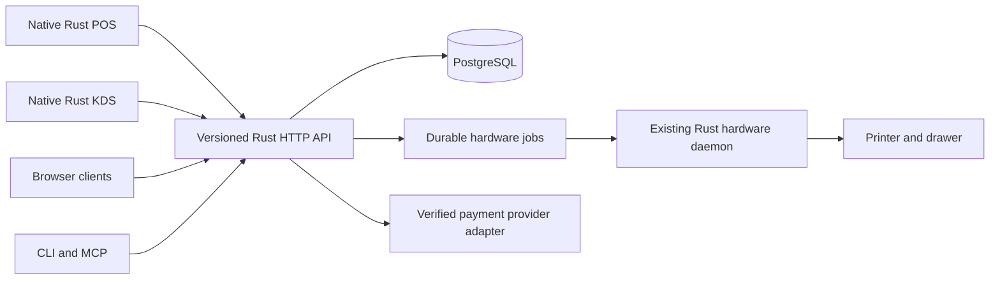

# CulinaryOS Rust rebuild plan

The [Native platform plan](NATIVE_PLATFORM_PLAN.md) supersedes this initial proposal for company enrollment, device roles, installers, networking and support.

Status: proposed for review, November 11, 2026. Scope assumes a Rust server, native POS and KDS, native operator tools, and a managed Railway release. Preserve the guest and back-office browser entry points. A Rust/Wasm browser rebuild is a separate decision because those clients still need to run in a browser. Keep product source in the CulinaryOS repository with an independent Cargo workspace and release pipeline.

## Baseline and scope

The existing production HTTP tests prove PostgreSQL startup and restart, owner sign-in, order persistence, ticket delivery and listing, and cash retry deduplication on synthetic data. KDS actions, browser workflows, drawer close, real hardware, and Railway acceptance remain open. Inventory existing routes, screens, CLI and MCP commands by capability. Label each as verified, present but unverified, or missing. Define intended behavior for gaps before porting them.

The rebuild would replace the desktop UI and API implementation while carrying forward the data and operating rules. The existing Rust hardware daemon in packages/hardware/daemon is the first reuse candidate. Existing TypeScript applications provide the comparison baseline and remain available through migration.

## Product requirements and acceptance

| ID | Requirement | Evidence |
| --- | --- | --- |
| R01 | Installable native POS and KDS | Signed Windows pilot installer, launch on clean target devices, accessible touch and keyboard paths |
| R02 | Reliable restaurant workflow | Owner sign-in, menu, order edits, send, ticket fire/hold/bump, cash and drawer close |
| R03 | Reliable local operation | LAN operation during WAN loss, durable queue during local-server loss, deterministic replay, no duplicate effects |
| R04 | Existing data and permissions survive migration | Restricted DB role, RLS and cross-tenant tests, backup/restore rehearsal, cent-for-cent ledger reconciliation |
| R05 | Managed Railway release | Separate approved-customer databases, preview isolation, provisioning retries and tested recovery |
| R06 | Measurable terminal performance | Compare cold launch, memory, input response, order-to-ticket p95 and reconnect on the same pilot hardware |
| R07 | Operator and integration parity | CLI and MCP inventory, equivalent API authorization, explicit errors for unsupported operations |

## Target architecture

Deploy that server on the private LAN or on Railway with a separate database per approved customer. Keep admin database credentials in provisioning tooling. The running service uses a restricted runtime role. The client owns pending operations and local presentation. The server owns identity, pricing, orders, payments, kitchen state and authoritative operation receipts.

Evaluate Axum for HTTP routing and Slint for the compiled desktop UI. Compare the native UI on the actual Windows touchscreen and any proposed Linux kiosk before choosing it. Check accessibility, input methods, licensing terms, GPU and software-rendering behavior, installer size, and maintenance burden. Choose a PostgreSQL driver by proving restricted-role transactions, connection pooling, cancellation and TLS in the prototype. Keep crates coarse at first: shared domain, server, desktop and operator tools. Reuse the existing daemon where its tested interface fits.

References: [Axum documentation](https://docs.rs/axum/latest/axum/) and [Slint Rust backend and accessibility documentation](https://docs.slint.dev/latest/docs/rust/slint_interpreter/).

## Execution stages

| Stage | Deliverable | Exit gate |
| --- | --- | --- |
| 0. Contract and baseline | Inventory behavior and extract reusable HTTP fixtures. Finish reference KDS actions and cash close. Profile the current clients on pilot hardware. | Shared fixtures cover expected payloads, errors, auth, ordering and side effects. Performance targets agreed before comparison. |
| 1. Native UI experiment | Small Rust KDS app against the existing API, showing a live station ticket and completing a bump. | Touch, keyboard, screen reader, reconnect and resource comparison on target hardware. Keep results and choose the UI framework. |
| 2. Rust server foundation | Readiness, configuration, tracing, bootstrap and tenant transactions, then owner PIN login and menu reads. | Same HTTP fixture suite passes, including restricted role and cross-tenant denial. Restart preserves identity and data. |
| 3. Core restaurant workflow | Rust order and kitchen logic, native POS and KDS, durable replay, cash settlement and drawer reconciliation. | Order through kitchen and drawer close on synthetic PostgreSQL. Concurrent attempts, response loss and replay preserve exact totals and single side effects. |
| 4. Devices and providers | Connect the hardware daemon, payment adapter, CLI and MCP. Port remaining pilot features and verify each device and provider path. | Physical printer and drawer, signed provider webhooks, replay protection, verified settlement and operator acceptance. |
| 5. Release and migration | Signed LAN packages, backup and restore, and a separate Railway preview with two synthetic customers. | Clean-machine install, restart, WAN outage, crash recovery, restore, isolated provisioning and canary approval. Expand only after these checks. |

The first implementation slice is stages 0 and 1 for one KDS station. It makes the desktop choice testable while the current server and data are available. After the prototype, record the measured tradeoffs and approve the server port separately.

## Data migration and rollback

Reuse the native PostgreSQL migration ledger and schema as the initial compatibility target. Compare the legacy Supabase schema separately. Where legacy data needs conversion, rehearse an explicit export/import with row counts, ID mapping and per-order and per-payment totals. Use additive migrations through the compatibility window and test old and new code against the same schema.

Run comparison tests on disposable copies. Use one authoritative writer per live installation during a cutover. Capture a verified backup and record the point of cutover. Exercise restoring and reconciling post-cutover writes before a production pilot. Reverting the executable works only while the schema is compatible. If a migration breaks compatibility, the rollback drill must include restoring and reconciling every order and payment recorded since the backup.

## Performance and safety gates

Measure both candidates with the same hardware, data, network and workflow. Record cold and warm launch, idle and peak memory, CPU, tap response and p95 order-to-ticket latency under rush load. Time WAN disconnect, local-server reconnect and queue drain separately. Choose numeric budgets once pilot hardware and the baseline are known. Duplicate tickets or charges, lost acknowledged orders, tenant leakage and unexplained cash variance fail acceptance regardless of speed.

